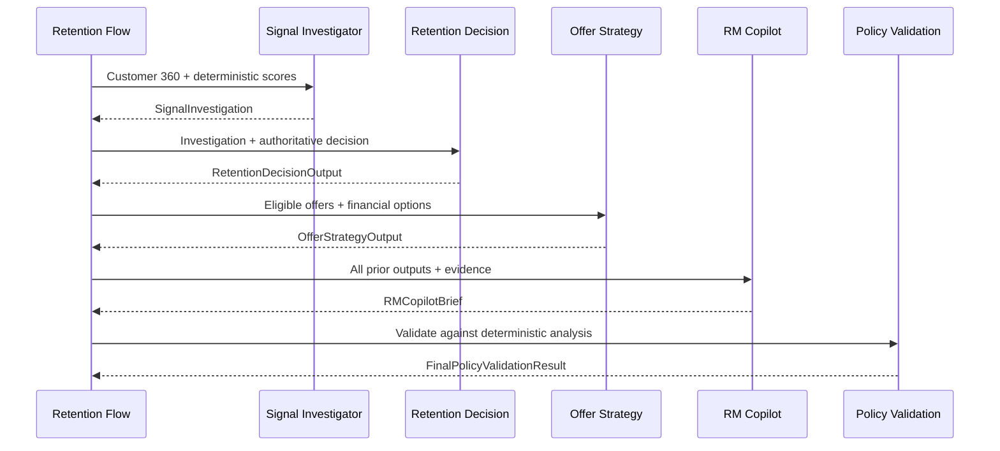
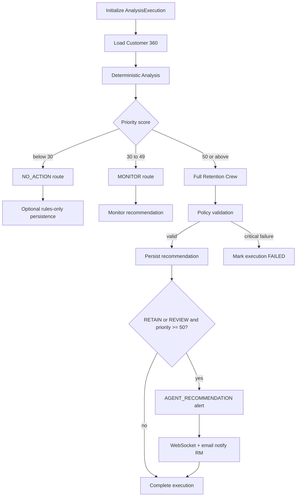
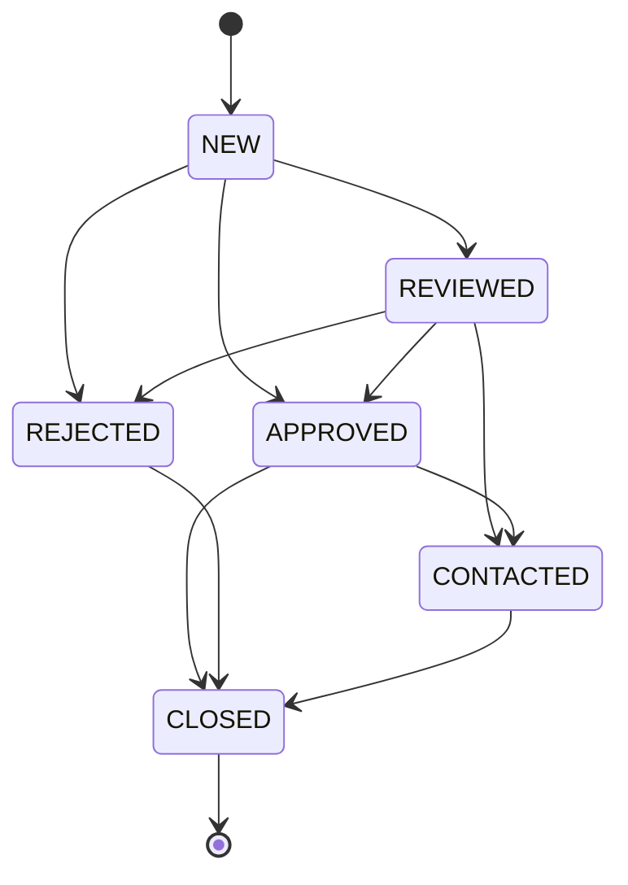

# RetainAI

**Agentic AI customer-retention copilot for retail banking Relationship Managers**

RetainAI helps Relationship Managers proactively retain customers by surfacing churn risk, deterministic eligibility scores, and AI-assisted explanations grounded in approved retention offers—all powered by synthetic data for safe local development.

## Problem Statement

Retail banking Relationship Managers manage large customer portfolios under time pressure. Identifying who is at risk of leaving, which retention offers apply, and how to prioritize outreach is often manual and inconsistent. RetainAI combines deterministic business logic (scoring, eligibility, approved offers) with an agentic copilot that explains insights and recommends next steps—without letting the LLM alter scores or invent offers.

## Architecture Summary

```text
retain-ai/
├── backend/          # FastAPI + SQLModel + CrewAI
├── frontend/         # React + TypeScript + Vite
├── scripts/          # Dev and validation scripts
├── docs/             # Extended documentation
├── docker/           # Container definitions (later phases)
├── .env.example      # Environment variable template
└── docker-compose.yml
```

```text
┌─────────────────────────────────────────────────────────────────┐
│                     React + TypeScript (Vite)                   │
│   Dashboard · Portfolio · Alerts (WebSocket) · Copilot Chat     │
└────────────────────────────┬────────────────────────────────────┘
                             │ REST / WebSocket
┌────────────────────────────▼────────────────────────────────────┐
│                      FastAPI (Python 3.11+)                       │
│  ┌──────────────┐  ┌──────────────┐  ┌──────────────────────┐ │
│  │ Scoring      │  │ Approved     │  │ CrewAI Agents        │ │
│  │ (deterministic)│ │ Offers       │  │ (Pydantic outputs)   │ │
│  └──────────────┘  └──────────────┘  └──────────────────────┘ │
│  ┌──────────────┐  ┌──────────────┐  ┌──────────────────────┐ │
│  │ asyncio.Queue│  │ WebSockets   │  │ SMTP (dev alerts)    │ │
│  └──────────────┘  └──────────────┘  └──────────────────────┘ │
└────────────────────────────┬────────────────────────────────────┘
                             │
                    ┌────────▼────────┐
                    │ SQLite (MVP)    │
                    │ Synthetic data  │
                    └─────────────────┘
```

### Key design constraints

- **Deterministic scoring** — churn and credit eligibility are computed by services, not the LLM.
- **Approved offers only** — the copilot may recommend only offers from the approved-offer service.
- **Structured AI output** — all LLM responses validate against Pydantic schemas.
- **Mock mode** — set `MOCK_LLM_MODE=true` to run without a live LLM.
- **MVP simplicity** — SQLite, in-memory `asyncio.Queue`; no Kafka, Redis, Celery, or microservices.

See [PROJECT_REQUIREMENTS.md](./PROJECT_REQUIREMENTS.md) for the full requirements list and [IMPLEMENTATION_STATUS.md](./IMPLEMENTATION_STATUS.md) for current progress.

## Prerequisites

- Python 3.11+ (3.13 tested)
- [uv](https://docs.astral.sh/uv/) for Python dependency management (`pip install uv`)
- Node.js 20+ and npm

## Backend Setup

```bash
cp .env.example .env
cd backend
uv sync --all-groups
uv run uvicorn app.main:app --reload --host 0.0.0.0 --port 8000
```

Health checks:

```bash
curl http://localhost:8000/health
curl http://localhost:8000/api/v1/health
```

See [backend/README.md](./backend/README.md) for package layout and Makefile commands.

## Frontend Setup

```bash
cd frontend
npm install
npm run dev
```

The dev server runs at http://localhost:5173. See [frontend/README.md](./frontend/README.md) for details.

## Environment Variables

Copy the template and adjust as needed:

```bash
cp .env.example .env
```

Key variables:

| Variable | Purpose |
|----------|---------|
| `MOCK_LLM_MODE` | Run without a live LLM (`true` for local dev) |
| `DATABASE_URL` | SQLite connection string |
| `FRONTEND_ORIGIN` | CORS origin for the Vite dev server |
| `QWEN_*` | OpenAI-compatible Qwen endpoint settings |
| `SMTP_*` | Development email (e.g. Mailhog on port 1025) |
| `ALERT_PRIORITY_THRESHOLD` | Score threshold for high-priority alerts and email |
| `REVIEW_PRIORITY_THRESHOLD` | Minimum score for MEDIUM preview alerts (default 50) |
| `QUEUE_WORKER_COUNT` | Background event worker count (default 1) |
| `EVENT_MAX_RETRIES` | Maximum retries for failed events |
| `EMAIL_NOTIFICATIONS_ENABLED` | Enable SMTP alert emails |
| `WEBSOCKET_HEARTBEAT_SECONDS` | WebSocket heartbeat interval |
| `MOCK_LLM_MODE` | Run agents without a live LLM (`true` for local dev) |
| `QWEN_*` | OpenAI-compatible Qwen endpoint settings |
| `AGENT_MAX_ITERATIONS` | Maximum CrewAI agent iterations (default 4) |
| `CHURN_PRIORITY_WEIGHT` | Weight for churn score in priority formula (default 0.55) |
| `VALUE_PRIORITY_WEIGHT` | Weight for value score in priority formula (default 0.45) |
| `SEND_EMAIL_MIN_PRIORITY` | Minimum priority for agent alert email (default 70) |
| `CHAT_HISTORY_ENABLED` | Persist RM chat messages (default true) |
| `CHAT_MAX_HISTORY_MESSAGES` | Max prior messages in context (default 12) |
| `CHAT_MAX_MESSAGE_LENGTH` | Max user message length (default 2000) |
| `CHAT_MAX_TOOL_CALLS` | Max safe tools per chat turn (default 6) |
| `CHAT_TIMEOUT_SECONDS` | Chat request timeout (default 45) |
| `CHAT_CONVERSATION_TTL_HOURS` | Conversation expiry (default 24) |

Full list: [.env.example](./.env.example)

## Synthetic Demo Data

All customer names, emails, account numbers, balances, and events in RetainAI are **completely fictional**. The scenarios below are designed for local development and testing only — they **do not represent actual bank policies, real customers, or production decision rules**.

Load or reset the synthetic dataset from the `backend/` directory:

```bash
cd backend
uv run python ../scripts/reset_database.py
uv run python ../scripts/reset_database.py --reset
```

### Fictional customer scenarios

| ID | Profile | Key signals | Expected future outcome |
|----|---------|-------------|-------------------------|
| C001 | High-value priority salary customer since 2017 | External home-loan inquiry, 42% balance decline, large external transfer, excellent credit, zero DPD | Urgent retention |
| C002 | Mass-affluent card-active customer | External credit-card inquiry, good credit score, low DPD, strong card spending | Card upgrade or annual-fee-waiver review |
| C003 | Salary-dependent customer | Salary credit stopped, repeated transfers to another bank, declining balance, good credit | Immediate RM relationship call |
| C004 | Distressed borrower | High churn signals, 60 DPD, weak credit | Service or repayment assistance; no new lending offer |
| C005 | Long-tenure customer | Declining product usage, no strong external trigger | Relationship reactivation or monitoring |
| C006 | Low-value stable customer | One low-severity external inquiry, otherwise stable transactions | Monitor or no action |
| C007 | Frequent traveller | High forex spending, external travel-card inquiry | Travel-card recommendation |
| C008 | Priority depositor | Large fixed deposit maturing soon, recent external transfer, high customer value | Fixed-deposit renewal retention action |
| C009 | High-value investor | Increasing transfers to external investment platforms | Wealth-management referral subject to RM review |
| C010 | Stable customer | No material risk signals | No action |

Seed sources: `CORE_BANKING`, `CREDIT_BUREAU`, `TRANSACTION_ENGINE`, and `CRM` JSON files under `backend/app/seed/`.

## Customer 360 API

After seeding the database, the following endpoints are available:

```bash
# List customers (paginated)
curl "http://localhost:8000/api/v1/customers?page=1&page_size=10"

# Search and filter
curl "http://localhost:8000/api/v1/customers?search=Ananya&segment=PRIORITY"

# Sort by estimated annual value descending
curl "http://localhost:8000/api/v1/customers?sort_by=estimated_annual_value&sort_order=desc"

# Customer detail
curl http://localhost:8000/api/v1/customers/C001

# Customer 360 aggregated view
curl http://localhost:8000/api/v1/customers/C001/360
```

The Customer 360 response includes customer profile, accounts, credit profile, bureau triggers, transaction features, recommendations, recent interactions, per-source freshness metadata, and non-fatal data warnings when optional sources are missing or stale.

Missing customers return the standard error envelope:

```json
{
  "error": {
    "code": "CUSTOMER_NOT_FOUND",
    "message": "Customer C999 was not found",
    "details": {}
  }
}
```

## Deterministic Decision Engine

The rules-only decision engine computes **explainable, deterministic** retention scores and offer eligibility. These are **demo rules for local development** — they are **not actual bank policy**, and all inputs are **synthetic**.

### Scoring

**Churn risk (0–100)** — sum of triggered rule points, capped at 100. Each triggered rule returns a `RuleContribution` with points, observed value, and source system (`CORE_BANKING`, `CREDIT_BUREAU`, `TRANSACTION_ENGINE`, `CRM`).

Suggested churn bands: 0–29 LOW, 30–49 MEDIUM, 50–69 HIGH, 70–100 CRITICAL.

**Customer value (0–100)** — weighted components:

- Balance and deposit value (max 35)
- Monthly inflow (max 20)
- Estimated annual customer value (max 20)
- Product depth (max 15)
- Relationship tenure (max 10)

### Priority formula

```text
priority_score = round((churn_score × CHURN_PRIORITY_WEIGHT) + (value_score × VALUE_PRIORITY_WEIGHT))
```

Default weights: churn 0.55, value 0.45.

### Action bands

| Priority score | Decision |
|----------------|----------|
| 70–100 | RETAIN |
| 50–69 | REVIEW |
| 30–49 | MONITOR |
| below 30 | NO_ACTION |

### Eligibility disclaimer

Offer eligibility indicates an **RM discussion option** and **does not represent final credit or product approval**. This disclaimer is included in eligibility responses.

### Financial formulas (estimates, not guaranteed revenue)

```text
churn_probability = churn_score / 100
revenue_at_risk = estimated_annual_value × churn_probability
expected_gross_retention_value = revenue_at_risk × expected_retention_uplift
expected_net_benefit = expected_gross_retention_value − estimated_offer_cost
```

Financial projections are **estimates** based on synthetic data.

### Rules-only analysis API

```bash
# Synchronous rules-only analysis (no LLM, no persistence)
curl -X POST http://localhost:8000/api/v1/analysis/C001/rules-only
```

Returns churn/value/priority scores, eligible and rejected offers, financial options, top risk signals, and a suggested action.

### Portfolio APIs

```bash
# Portfolio summary across all 10 customers
curl http://localhost:8000/api/v1/portfolio/summary

# Portfolio customer table (default sort: priority_score desc)
curl "http://localhost:8000/api/v1/portfolio/customers?page=1&page_size=10"

# Filter by decision or minimum priority
curl "http://localhost:8000/api/v1/portfolio/customers?decision=RETAIN&minimum_priority=70"
```

### Recommendation read APIs

```bash
curl "http://localhost:8000/api/v1/recommendations?page=1&page_size=20"
curl http://localhost:8000/api/v1/recommendations/{recommendation_id}
```

These endpoints return persisted recommendations from the agentic retention flow, including scores, RM brief fields, policy warnings, and interaction history.

## Agentic Retention Workflow (Phase 5)

Events and manual analysis invoke the **Retention Flow**, which routes by deterministic priority score and optionally runs the four-agent **Retention Crew**. Deterministic scores remain authoritative; agents explain, select eligible offers, and produce RM briefs only.

### Retention Crew sequence



### Flow routing



| Priority | Route | Crew | Alert | Email (default) |
|----------|-------|------|-------|-----------------|
| below 30 | NO_ACTION | No | No | No |
| 30–49 | MONITOR | No | No | No |
| 50+ | RETAIN/REVIEW | Yes | Yes (AGENT_RECOMMENDATION) | Yes when priority ≥ 70 |

Configuration (see `.env.example`):

- `PERSIST_NO_ACTION_RECOMMENDATIONS` — save rules-only NO_ACTION outcomes
- `RUN_FULL_CREW_MIN_PRIORITY` — minimum priority to run full crew (default 50)
- `CREATE_ALERT_MIN_PRIORITY` — minimum priority for final agent alert (default 50)
- `SEND_EMAIL_MIN_PRIORITY` — minimum priority for agent alert email (default 70)

### Manual analysis API

```bash
# Queue agentic analysis (returns 202 immediately)
curl -X POST http://localhost:8000/api/v1/analysis/C001 \
  -H "Content-Type: application/json" \
  -d '{"notifications_enabled": true, "force_reanalysis": false}'

# Poll execution status
curl http://localhost:8000/api/v1/analysis/executions/{execution_id}

# List executions with filters
curl "http://localhost:8000/api/v1/analysis/executions?customer_id=C001&status=COMPLETED"
```

### Recommendation lifecycle



RM action endpoints:

```bash
curl -X POST http://localhost:8000/api/v1/recommendations/{id}/review \
  -H "Content-Type: application/json" -d '{"rm_id": "RM001", "notes": "Reviewed"}'

curl -X POST http://localhost:8000/api/v1/recommendations/{id}/approve \
  -H "Content-Type: application/json" -d '{"rm_id": "RM001"}'

curl -X POST http://localhost:8000/api/v1/recommendations/{id}/reject \
  -H "Content-Type: application/json" \
  -d '{"rm_id": "RM001", "rejection_reason": "Customer already retained"}'

curl -X POST http://localhost:8000/api/v1/recommendations/{id}/contacted \
  -H "Content-Type: application/json" \
  -d '{"rm_id": "RM001", "contact_channel": "PHONE", "offer_presented": true}'

curl -X POST http://localhost:8000/api/v1/recommendations/{id}/close \
  -H "Content-Type: application/json" \
  -d '{"rm_id": "RM001", "closing_note": "Case resolved"}'
```

**Human approval disclaimer:** RM approval means authorization to **discuss** the recommendation. It does **not** represent credit, product, or pricing approval.

### Event-to-recommendation flow

```text
POST /api/v1/events
        │
        ▼
  Apply event mutation (idempotent)
        │
        ▼
  Create AnalysisExecution (AGENTIC)
        │
        ▼
  Retention Flow (routing + optional Crew)
        │
        ▼
  Persist Recommendation + AGENT_RECOMMENDATION alert
        │
        ▼
  WebSocket + email (after commit; failure does not roll back recommendation)
```

Final `AGENT_RECOMMENDATION` alerts are separate from any existing `RULES_PREVIEW` alerts and include `recommendation_id` in the WebSocket payload.

## Event Processing Architecture

Inbound customer events are ingested asynchronously. The API validates payloads, persists events, and enqueues them for background workers. Workers apply synthetic source updates, run the **Retention Flow** (deterministic analysis + optional Crew), persist recommendations, create **AGENT_RECOMMENDATION** alerts, and deliver notifications.

```text
POST /api/v1/events
        │
        ▼
  Validate customer + payload
        │
        ▼
  Idempotency check (DB-backed)
        │
        ▼
  Persist event (RECEIVED → QUEUED)
        │
        ▼
  asyncio.Queue  ──►  Worker(s)
        │                 │
        │                 ├─ Apply event to source records
        │                 ├─ Retention Flow (Crew when priority ≥ 50)
        │                 ├─ Store analysis snapshot + link execution
        │                 ├─ Create AGENT_RECOMMENDATION alert (when eligible)
        │                 └─ WebSocket + email notifications (after commit)
        ▼
  HTTP 202 response (immediate)
```

### asyncio.Queue MVP limitation

The in-process `asyncio.Queue` is **non-durable**. Events still in the queue are **lost if the process stops**. This is intentional for the MVP — use a durable broker (Redis, Kafka, etc.) in production.

After model changes, reset the local database:

```bash
cd backend
uv run python ../scripts/reset_database.py --reset
```

### Supported event types

| Event type | Description |
|------------|-------------|
| `EXTERNAL_HOME_LOAN_INQUIRY` | Bureau trigger for external home-loan inquiry |
| `EXTERNAL_CARD_INQUIRY` | Bureau trigger for external card inquiry |
| `SALARY_CREDIT_STOPPED` | Salary not received this month |
| `SALARY_CREDIT_RESUMED` | Salary received again |
| `LARGE_EXTERNAL_TRANSFER` | Large transfer to external destination |
| `FIXED_DEPOSIT_MATURITY` | Fixed deposit approaching or at maturity |
| `FOREX_SPEND_INCREASE` | Elevated forex spending |
| `DPD_CHANGED` | Days-past-due change on credit profile |
| `PRODUCT_USAGE_DECLINE` | Product inactivity / card spend decline |
| `BALANCE_DECLINE` | Balance decline over 30 days |
| `INVESTMENT_TRANSFER_INCREASE` | Transfers to external investment platforms |
| `MANUAL_REANALYSIS` | Re-run analysis without mutating source data |

### Example event request

```bash
curl -X POST http://localhost:8000/api/v1/events \
  -H "Content-Type: application/json" \
  -d '{
    "customer_id": "C001",
    "event_type": "EXTERNAL_HOME_LOAN_INQUIRY",
    "source_system": "CREDIT_BUREAU",
    "payload": {
      "severity": "HIGH",
      "amount_band": "500000-1000000",
      "trigger_date": "2026-07-01"
    },
    "idempotency_key": "demo-home-loan-001",
    "notifications_enabled": true
  }'
```

Returns HTTP **202** with an `IncomingEventResponse`. Duplicate idempotency keys return the existing event with `"duplicate": true`.

### Event status progression

```text
RECEIVED → QUEUED → PROCESSING → COMPLETED
                              └─► FAILED (retryable up to EVENT_MAX_RETRIES)
```

Query event status:

```bash
curl http://localhost:8000/api/v1/events/{event_id}
curl "http://localhost:8000/api/v1/events?customer_id=C001&status=COMPLETED"

# Retry a failed event
curl -X POST http://localhost:8000/api/v1/events/{event_id}/retry
```

### Alert APIs

```bash
curl "http://localhost:8000/api/v1/alerts?customer_id=C001&acknowledged=false"
curl http://localhost:8000/api/v1/alerts/{alert_id}

curl -X PATCH http://localhost:8000/api/v1/alerts/{alert_id}/acknowledge \
  -H "Content-Type: application/json" \
  -d '{"rm_id": "RM001", "note": "Review scheduled"}'
```

Preview alerts (`RULES_PREVIEW`) may still exist from earlier runs. Final agent alerts use type `AGENT_RECOMMENDATION` and include `recommendation_id`. Priority below `CREATE_ALERT_MIN_PRIORITY` (default 50) or `NO_ACTION` does not generate a final retention alert.

### WebSocket live alerts

Connect to `WS /ws/alerts` for real-time retention alerts:

```javascript
const ws = new WebSocket("ws://localhost:8000/ws/alerts");

ws.onmessage = (event) => {
  const message = JSON.parse(event.data);
  if (message.type === "RETENTION_ALERT") {
    console.log("Alert:", message.title, message.priority_score);
  }
};

// Heartbeat
ws.send(JSON.stringify({ type: "PING" }));
// Server responds: { "type": "PONG", "timestamp": "..." }
```

On connect the server sends:

```json
{
  "type": "CONNECTED",
  "message": "Connected to RetainAI alerts",
  "timestamp": "2026-07-08T12:00:00Z"
}
```

### Email notifications

When `EMAIL_NOTIFICATIONS_ENABLED=true` and priority meets `SEND_EMAIL_MIN_PRIORITY` (default 70), the backend sends agent recommendation emails via SMTP (e.g. Mailhog on port 1025).

- **Subject:** `RetainAI Agent Recommendation: {customer_id}`
- **Content:** customer ID, name, main signal, priority score, decision, recommended RM action, selected discussion offer, revenue at risk, expected net benefit, eligibility disclaimer
- **Not included:** raw transactions, account numbers, secrets, or model prompts

**Disclaimer (email and alerts):**

> This alert supports RM review. Product eligibility and financial estimates are indicative and do not represent final approval or guaranteed revenue.

SMTP failures are logged and do **not** fail event processing. Check safe configuration via:

```bash
curl http://localhost:8000/api/v1/system/notification-status
curl http://localhost:8000/api/v1/system/queue-status
curl http://localhost:8000/api/v1/system/llm-status
```

## LLM and Agent Foundation

RetainAI agents provide **decision support only**. They do not control eligibility, scoring, or offer approval. Deterministic services remain authoritative.

### Mock mode (default)

```env
MOCK_LLM_MODE=true
QWEN_BASE_URL=http://localhost:9000/v1
QWEN_API_KEY=not-required-for-local
QWEN_MODEL=Qwen/Qwen3-8B
```

With `MOCK_LLM_MODE=true`:

- No external network calls occur
- All four agents return deterministic, schema-valid outputs for seeded customers C001–C010
- Full test suite runs without a live Qwen endpoint

Real Qwen is **optional** for MVP development. Mock mode remains fully functional.

### Local Qwen mode

Set `MOCK_LLM_MODE=false` and run an OpenAI-compatible Qwen endpoint (for example on port 9000). CrewAI connects via `QWEN_BASE_URL` using low temperature (`QWEN_TEMPERATURE=0.1`), timeouts, and limited retries.

**Important:** Do not send real customer data to external endpoints. RetainAI uses synthetic data only.

### Agent responsibilities

| Agent | Purpose | Tools |
|-------|---------|-------|
| Signal Investigator | Identify primary retention signal and evidence | Customer 360, scores, interactions |
| Retention Decision | Explain deterministic decision and urgency | Customer 360, scores, interactions |
| Offer Strategy | Select best eligible offer discussion option | Customer 360, scores, eligible offers, financial options |
| RM Copilot | Produce RM-ready retention brief | Customer 360, scores, offers, interactions, financial options |

### Structured outputs and guardrails

All agent responses validate against Pydantic schemas in `app/schemas/agent_outputs.py`. Post-generation validation enforces: no score changes, eligible offers only, no approval claims, required disclaimers.

Shared policy in `app/core/agent_policy.py` requires agents to use tool data only, never invent financial values, and never promise approval or guaranteed revenue.

CrewAI Crew/Flow orchestration is implemented in `app/crews/retention_crew.py` and `app/flows/retention_flow.py`. Individual agents remain callable via `run_signal_investigator`, `run_retention_decision`, `run_offer_strategy`, and `run_rm_copilot`.

## RM Copilot Chat

The RM Copilot is a **decision-support assistant for Relationship Managers only**. It helps RMs understand portfolio priorities, customer risk, eligibility, and talking points — without contacting customers, approving products, or modifying scores or recommendations.

### Supported questions

- Who should I call today?
- Why is C001 urgent?
- Why is C004 not eligible for a loan?
- Which customers have recent home-loan inquiries?
- What offer is recommended for C008?
- Compare C001 and C008.
- How much revenue is currently at risk?
- Draft talking points for C003.
- Show high-value, high-risk customers.
- What is C001's recommendation status?
- Which customers have stale data?
- Why is DPD important for C004?

### Chat architecture

```text
POST /api/v1/chat
        │
        ▼
  Validate request + resolve conversation context
        │
        ▼
  Deterministic intent detection
        │
        ├─ MOCK_LLM_MODE=true ──► Safe read-only tools ──► Deterministic answer
        │
        └─ MOCK_LLM_MODE=false ─► Safe tools ──► Qwen structured output
        │
        ▼
  Safety validation (approval language, evidence, account numbers)
        │
        ▼
  Persist messages (when CHAT_HISTORY_ENABLED=true)
        │
        ▼
  ChatResponse with evidence + suggested follow-up questions
```

### Safe tool design

Twelve read-only tools in `app/tools/chat_tools.py`:

- Customer summary, risk explanation, eligibility, recommendation
- Priority customer list, portfolio summary, trigger search
- Customer comparison (2–5 IDs), data freshness, stale-data search
- RM talking points, recommendation status

Restrictions: no SQL, no writes, no customer contact, no score changes, no raw transactions or account numbers.

### Mock and Qwen behavior

| Mode | Behavior |
|------|----------|
| `MOCK_LLM_MODE=true` (default) | Deterministic intent + tool calls + templated answers; no network |
| `MOCK_LLM_MODE=false` | Qwen generates structured output from pre-fetched tool data; returns 503 if unavailable |

### Conversation context

- Limited history (`CHAT_MAX_HISTORY_MESSAGES`, default 12)
- Active customer tracking for follow-up questions
- Ambiguity detection when multiple customers discussed
- Conversations expire after `CHAT_CONVERSATION_TTL_HOURS` (default 24)

### Chat API examples

```bash
# Why is C001 urgent?
curl -X POST http://localhost:8000/api/v1/chat \
  -H "Content-Type: application/json" \
  -d '{"message":"Why is C001 urgent?","rm_id":"RM-01","customer_id":"C001"}'

# Who should I call today?
curl -X POST http://localhost:8000/api/v1/chat \
  -H "Content-Type: application/json" \
  -d '{"message":"Who should I call today?","rm_id":"RM-01"}'

# Compare two customers
curl -X POST http://localhost:8000/api/v1/chat \
  -H "Content-Type: application/json" \
  -d '{"message":"Compare C001 and C008.","rm_id":"RM-01"}'

# List conversations
curl "http://localhost:8000/api/v1/chat/conversations?rm_id=RM-01"

# Close a conversation
curl -X POST http://localhost:8000/api/v1/chat/conversations/{conversation_id}/close \
  -H "Content-Type: application/json" \
  -d '{"rm_id":"RM-01"}'
```

### Limitations and disclaimers

- Chat does not contact customers or approve products.
- Eligibility indicates an RM discussion option, not final credit or product approval.
- Financial values are estimates, not guaranteed revenue.
- No vector database; context is limited to recent conversation history.
- Unsupported requests (SQL, customer contact, arbitrary actions) return a safe refusal.

## Running Tests

```bash
# Backend
cd backend
uv run pytest

# Frontend build verification
cd frontend
npm run build
```

## Development Workflow

1. Copy `.env.example` to `.env` at the repo root.
2. Start the backend API: `cd backend && uv run uvicorn app.main:app --reload` (or `make run`)
3. Start the frontend: `cd frontend && npm run dev`
4. Run lint before committing:
   - Backend: `cd backend && uv run ruff check .` (or `make lint`)
   - Frontend: `cd frontend && npm run lint`

## License

<!-- TBD -->
