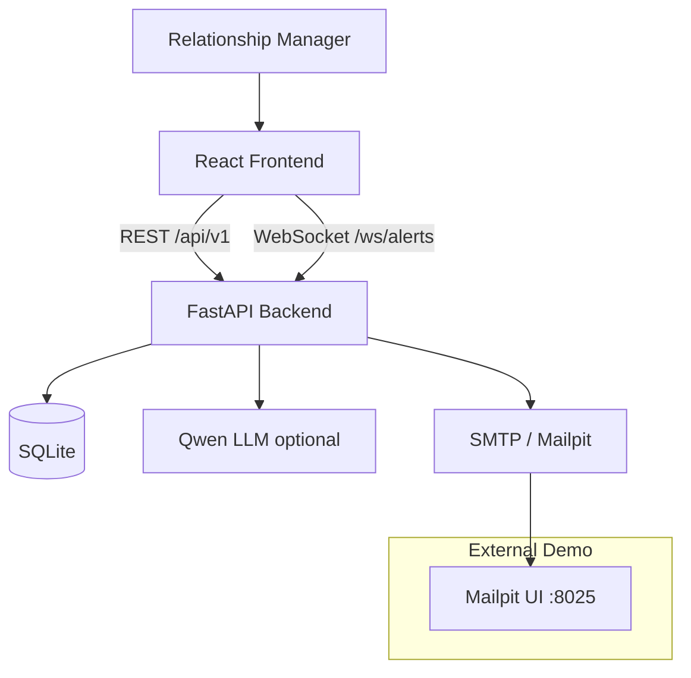
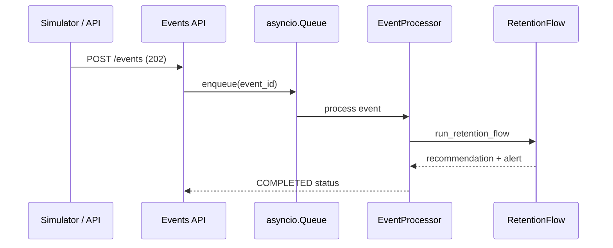
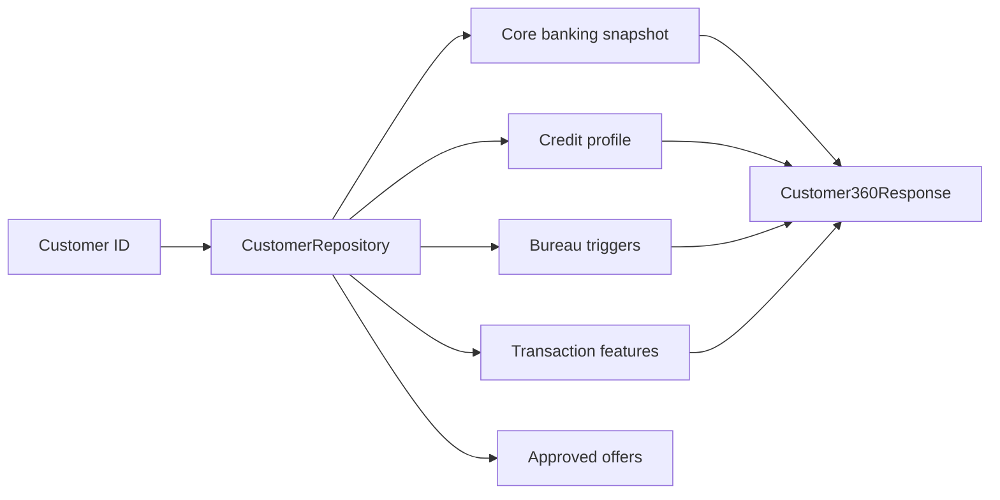
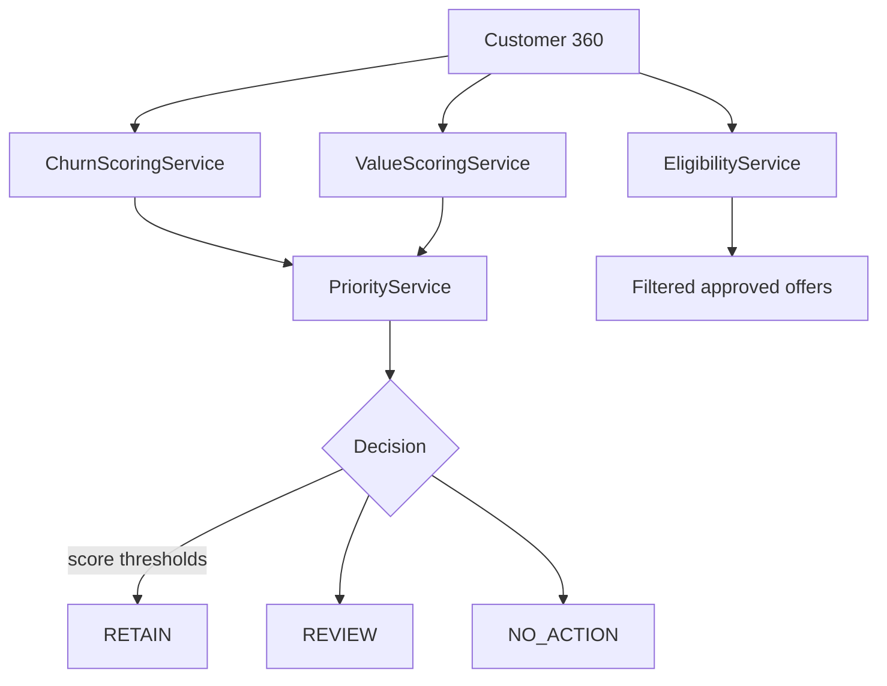
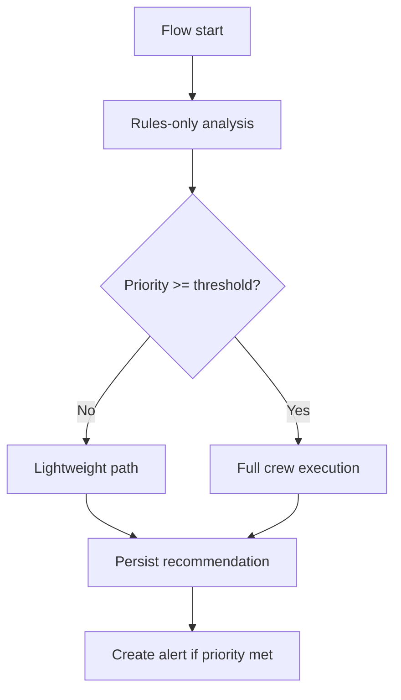
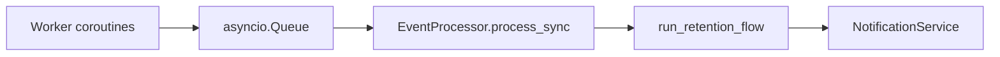
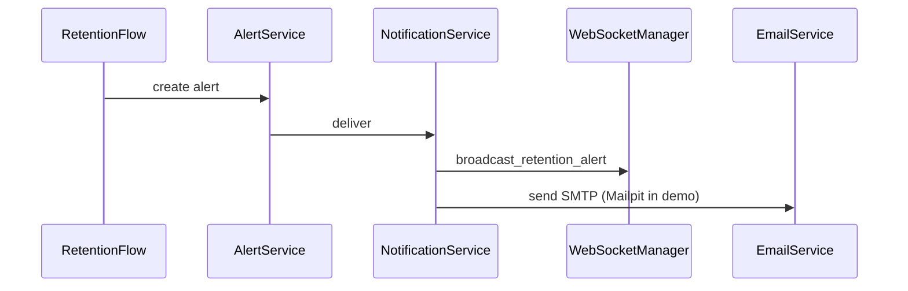
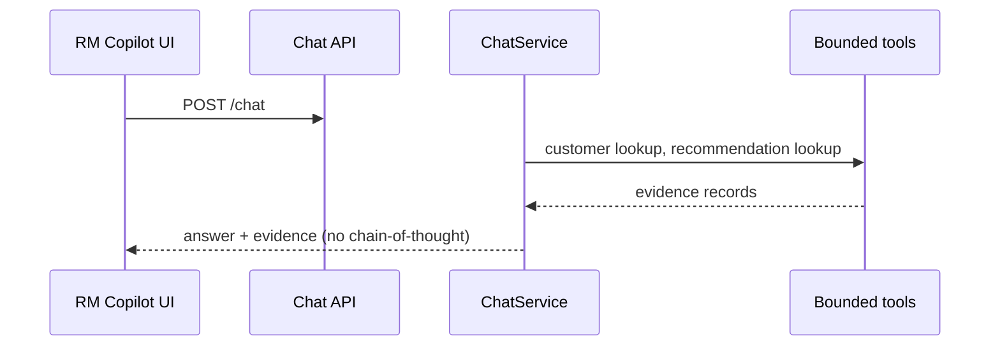
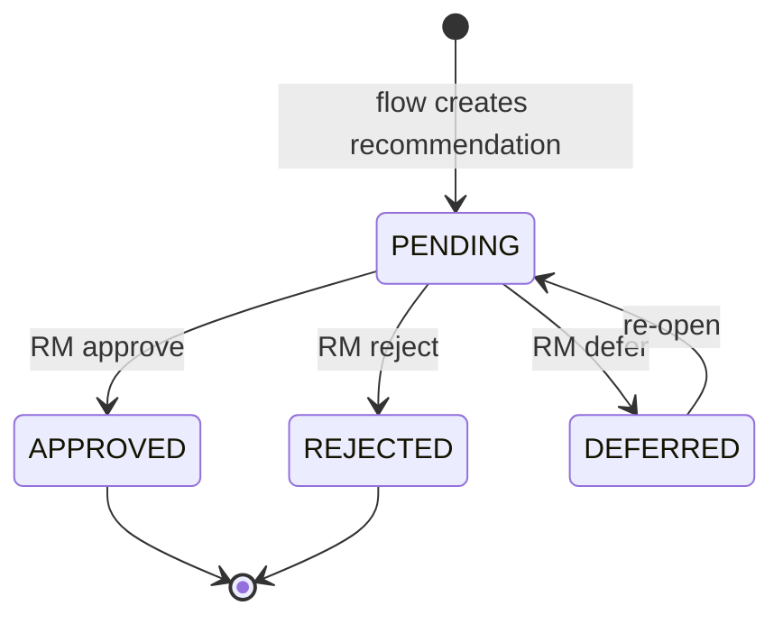
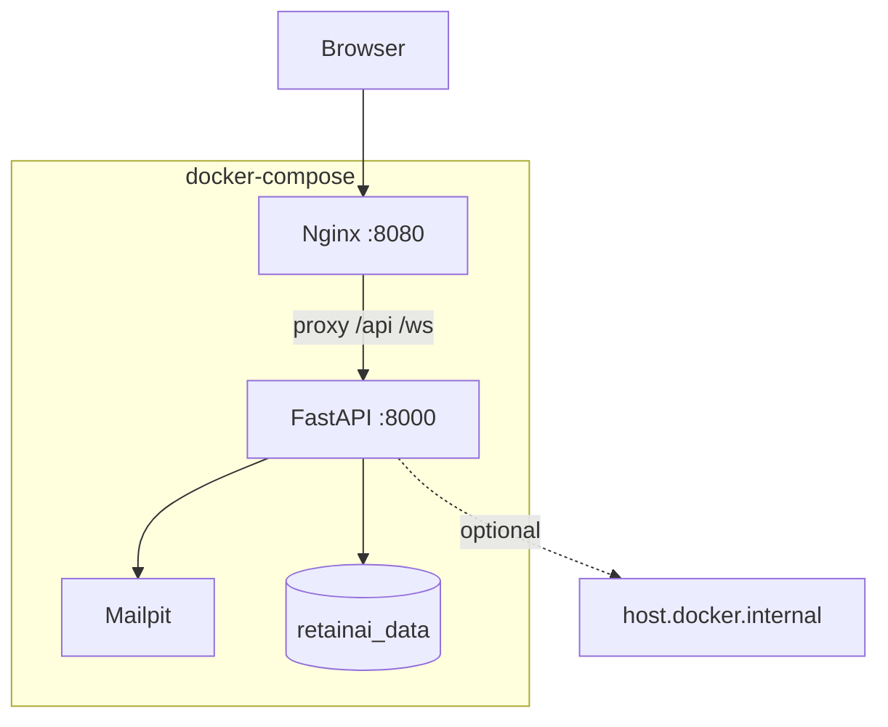

# Architecture — RetainAI

Agentic AI customer-retention copilot for retail banking RMs. **Synthetic data only** in this MVP.

## System context

## Layer overview

| Layer | Technology | Responsibility |
|-------|------------|----------------|
| Frontend | React, TypeScript, Vite | Dashboard, 360, alerts, copilot, simulator |
| API | FastAPI | REST, WebSocket, validation, thin routers |
| Persistence | SQLModel + SQLite | Customers, events, recommendations, audit |
| Rules engine | Python services | Churn, value, priority, eligibility (deterministic) |
| Agents | CrewAI + Pydantic | Narrative reasoning, offer framing, chat |
| Flow | CrewAI Flow | Route full crew vs. lightweight path |
| Queue | asyncio.Queue | Async event processing (non-durable) |
| LLM | Qwen via OpenAI-compatible API | Optional; mock mode default |
| Notifications | WebSocket + SMTP | Real-time alerts + email |

## Data ingestion

Events: bureau triggers, manual reanalysis, CRM signals. Payloads validated per `EventType`.

## Customer 360

Aggregates read-only snapshots; no raw transaction dump in API responses.

## Deterministic decision engine

**Design decision:** Rules remain deterministic so regulatory explainability and auditability are preserved. Scores are reproducible without LLM variance.

## CrewAI agent sequence

Four agents (mock or live Qwen):

1. **Retention Analyst** — interprets signals and context
2. **Offer Strategist** — selects from eligible offers only
3. **Risk Advisor** — policy warnings and guardrails
4. **RM Communicator** — customer-facing narrative

Agents output **Pydantic-validated** structures. They do **not** compute eligibility or invent offer IDs.

**Design decision:** Agents do not control eligibility — prevents LLM hallucination from bypassing credit policy.

## CrewAI Flow routing

`RUN_FULL_CREW_MIN_PRIORITY` gates expensive crew runs.

## Event queue processing

**Design decision:** `asyncio.Queue` is sufficient for MVP demos but is **non-durable** — queued events are lost on process stop. Production requires Redis/RabbitMQ + workers.

## Alert and email pipeline

Thresholds: `CREATE_ALERT_MIN_PRIORITY`, `SEND_EMAIL_MIN_PRIORITY`.

## RM chat

Mock mode returns deterministic answers with evidence citations.

## Recommendation lifecycle

**Design decision:** RM approval remains mandatory — no automatic product booking or customer contact.

## Docker deployment

See [DOCKER_SETUP.md](./DOCKER_SETUP.md).

## Mock mode

`MOCK_LLM_MODE=true` (default):

- Skips live Qwen HTTP calls
- Returns schema-valid mock agent and chat outputs
- Enables CI, Docker, and offline demos

**Design decision:** Mock mode is required for reproducible validation without GPU infrastructure.

## Key modules (backend)

| Path | Role |
|------|------|
| `app/api/` | Thin HTTP routers |
| `app/services/` | Business logic |
| `app/repositories/` | Persistence queries |
| `app/agents/` | CrewAI agent definitions |
| `app/flows/` | Retention flow orchestration |
| `app/core/policy_rules.py` | Deterministic guardrails |
| `app/seed/` | Synthetic data |

## Key modules (frontend)

| Path | Role |
|------|------|
| `src/pages/` | Route-level views |
| `src/api/` | Typed API client |
| `src/hooks/` | WebSocket, polling |
| `src/components/` | UI building blocks |

Frontend contains **no** scoring or eligibility logic — display and RM actions only.
