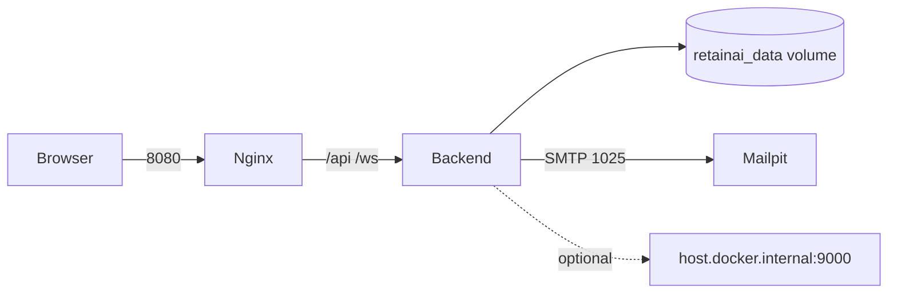

# Docker Setup — RetainAI

Local demonstration stack: **backend** (FastAPI), **frontend** (Nginx + React), and **Mailpit** (SMTP capture).

> **Synthetic data only.** Mailpit is local demo infrastructure — not production email.

## Prerequisites

| Requirement | Notes |
|-------------|-------|
| Docker Desktop | Windows, macOS, or Linux |
| Git clone | Repository root contains `docker-compose.yml` |
| Ports free | 8000, 8080, 1025, 8025 |

## Quick start

```bash
# From repository root
cp .env.example .env
docker compose build
docker compose up
```

Background mode:

```bash
docker compose up -d
```

Stop:

```bash
docker compose down
```

Reset database and volumes:

```bash
docker compose down -v
```

View logs:

```bash
docker compose logs -f
docker compose logs -f backend
```

## Service URLs

| Service | URL | Purpose |
|---------|-----|---------|
| Frontend | http://localhost:8080 | React SPA (same-origin API proxy) |
| Backend health | http://localhost:8000/health | Container health probe |
| API docs | http://localhost:8000/docs | OpenAPI / Swagger UI |
| API (direct) | http://localhost:8000/api/v1 | REST API |
| Mailpit UI | http://localhost:8025 | View captured emails |
| Mailpit SMTP | localhost:1025 | Backend SMTP target |

The frontend proxies `/api/` and `/ws/` to the backend through Nginx, so the browser uses:

- `http://localhost:8080/api/v1/...`
- `ws://localhost:8080/ws/alerts`

## Environment

1. Copy `.env.example` to `.env` at the repository root.
2. `docker-compose.yml` sets safe defaults; override in `.env` as needed.
3. No real secrets are baked into images or compose files.

Key Docker defaults (also in compose):

```env
DATABASE_URL=sqlite:////data/retain_ai.db
MOCK_LLM_MODE=true
SMTP_HOST=mailpit
SMTP_PORT=1025
EMAIL_NOTIFICATIONS_ENABLED=true
FRONTEND_ORIGIN=http://localhost:8080
QWEN_BASE_URL=http://host.docker.internal:9000/v1
```

SQLite data persists in the named volume `retainai_data` mounted at `/data`.

## Mock mode (default)

`MOCK_LLM_MODE=true` is the default. The stack runs fully without Qwen:

- Agentic analysis uses deterministic mock responses
- RM Copilot chat works offline
- Demo and smoke tests pass without GPU/LLM infrastructure

## Real Qwen on the host

To use a Qwen-compatible endpoint running on your machine:

1. Start Qwen (or compatible OpenAI API) on port 9000.
2. Set in `.env`:
   ```env
   MOCK_LLM_MODE=false
   QWEN_BASE_URL=http://host.docker.internal:9000/v1
   ```
3. `extra_hosts: host.docker.internal:host-gateway` in compose enables Windows Docker Desktop host access.

If Qwen is unavailable, set `MOCK_LLM_MODE=true` — the app degrades gracefully.

## Testing alerts and email

1. Start the stack: `docker compose up -d`
2. Open http://localhost:8080
3. Use the **Event Simulator** or trigger a high-priority scenario (e.g. C001 home-loan inquiry)
4. Open http://localhost:8025 to view captured RM alert emails

Email is never sent to real addresses in this demo configuration.

## Smoke test (Docker backend)

With services running:

```bash
cd backend
uv run python ../scripts/smoke_test.py --base-url http://localhost:8000
```

## Health checks

| Service | Probe |
|---------|-------|
| Backend | `GET /health` every 30s |
| Frontend | `GET /` (Nginx) every 30s |

Backend waits for Mailpit to start; frontend waits for a healthy backend.

## Troubleshooting

### Port conflicts

Another process may use 8000, 8080, or 8025. Change host mappings in `docker-compose.yml` or stop conflicting services.

### Database permissions

The backend runs as non-root user `retainai`. The `retainai_data` volume must be writable at `/data`. If seed fails, run `docker compose down -v` and restart.

### WebSocket proxy

If alerts do not appear live, confirm:

- Frontend uses `ws://localhost:8080/ws/alerts`
- Nginx `location /ws/` includes `Upgrade` and `Connection` headers (see `frontend/nginx.conf`)

### Backend health check failing

```bash
docker compose logs backend
curl http://localhost:8000/health
```

Common causes: seed script error, port binding, missing volume.

### Qwen unavailable

Set `MOCK_LLM_MODE=true`. Agentic flows continue with mock LLM responses.

### Mailpit unavailable

Backend starts even if Mailpit is down; email delivery may fail but API remains healthy. Restart Mailpit: `docker compose restart mailpit`.

## Windows-specific notes

- Use **Docker Desktop** with WSL2 backend for best performance.
- `host.docker.internal` resolves via `extra_hosts: host-gateway`.
- Line endings: `docker-entrypoint.sh` must use LF (handled in repo).
- Firewall: allow Docker Desktop on ports 8000 and 8080 for browser access.

## Architecture (Docker)



See [ARCHITECTURE.md](./ARCHITECTURE.md) and [DOCKER_SETUP.md](./DOCKER_SETUP.md) companion docs.
