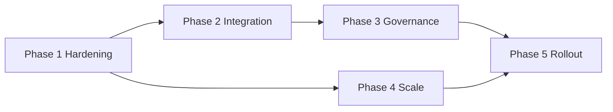

# Production Roadmap — RetainAI

Phased path from MVP prototype to bank production deployment.

## Phase 1 — Prototype hardening

**Goal:** Make the stack operable in a secured internal environment.

| Item | Current MVP | Target |
|------|-------------|--------|
| Database | SQLite | PostgreSQL with connection pooling |
| Task queue | asyncio.Queue | Redis + Celery (or ARQ) |
| Authentication | None | OAuth2 / bank SSO |
| Authorization | None | Role-based access control |
| Migrations | init_db | Alembic versioned migrations |
| Logging | Structured stdout | Centralized (ELK, Datadog) |
| Monitoring | Health endpoint | Metrics, alerts, SLOs |
| Secrets | .env | Vault / cloud secrets |
| CI/CD | Manual | Automated test + deploy pipeline |

**Exit criteria:** Authenticated RM can process events end-to-end in staging with durable queue.

## Phase 2 — Bank integration

**Goal:** Replace synthetic seed with governed production data feeds.

- Core banking connectors (balances, products, tenure)
- Bureau event feeds (inquiry triggers)
- Transaction feature pipeline (aggregated, consented)
- CRM integration (RM assignments, interaction history)
- Approved offer service (live product catalog)
- Customer consent and purpose-limitation system
- Data quality monitors and stale-data alerts

**Exit criteria:** Customer 360 reflects T-1 production data with audit trail.

## Phase 3 — Model and governance

**Goal:** Move from rule-based churn to governed ML with explainability.

- Calibrated churn model (training pipeline)
- Model registry and versioning
- Fairness and bias review
- Explainability (SHAP, reason codes)
- Policy versioning (eligibility rules as code)
- Model monitoring (drift, performance decay)
- Human override analytics

**Exit criteria:** Model risk committee approval for pilot segment.

## Phase 4 — Scale and resilience

**Goal:** Support thousands of RMs and high event volume.

- Redis or enterprise message broker
- Distributed workers (Celery/Kubernetes jobs)
- Kubernetes deployment with HPA
- High availability (multi-AZ)
- Disaster recovery (RPO/RTO defined)
- Observability (tracing, dashboards)
- WebSocket scaling (Redis pub/sub)

**Exit criteria:** Load test passes at 10× pilot volume with defined SLOs.

## Phase 5 — Business rollout

**Goal:** Measure retention uplift and expand adoption.

- Pilot RM cohort (50–100)
- A/B testing framework (treatment vs. control)
- Retention uplift measurement
- Offer-cost monitoring vs. expected net benefit
- Customer experience review (no undue pressure)
- Compliance and legal approval
- Training and change management
- Executive KPI dashboard

**Exit criteria:** Statistically significant retention improvement or documented learnings.

## Dependency map

## What stays from MVP

These design choices should carry forward:

1. **Deterministic eligibility** — LLM never gates credit decisions
2. **Approved offers only** — no hallucinated products
3. **Human RM approval** — no automatic booking
4. **Structured agent outputs** — Pydantic validation
5. **Evidence-based copilot** — no chain-of-thought exposure

## Estimated timelines (illustrative)

| Phase | Duration | Team |
|-------|----------|------|
| 1 | 2–3 months | 3–4 engineers |
| 2 | 4–6 months | + data engineers, bank IT |
| 3 | 3–4 months | + ML ops, compliance |
| 4 | 2–3 months | + platform/SRE |
| 5 | 6–12 months | + business, change mgmt |

Timelines depend on bank integration complexity and regulatory path.

## Related documents

- [ARCHITECTURE.md](./ARCHITECTURE.md) — technical design
- [SECURITY.md](./SECURITY.md) — security controls
- [BUSINESS_CASE.md](./BUSINESS_CASE.md) — value hypothesis
